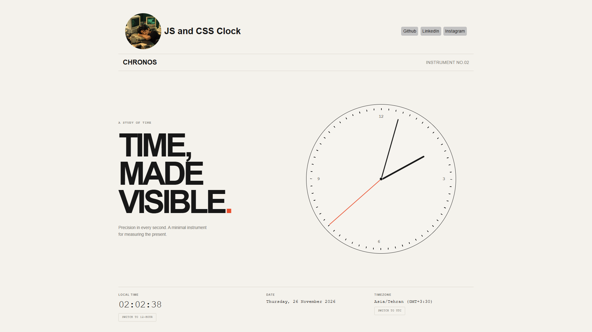

# CHRONOS — A Study of Time

A minimalist analog and digital clock built with HTML, CSS, and vanilla JavaScript as part of the **JavaScript30 Challenge — Day 02**.

CHRONOS explores the relationship between functionality and visual design through a Swiss Minimalist aesthetic, combining precise typography, a clean layout, and a classic analog clock.

## Preview

<!-- Add a screenshot of your project here -->


## Features

- Minimalist Swiss-inspired design.
- Analog clock with hour, minute, and second hands.
- Live digital time display.
- Current date display.
- Local timezone detection.
- Responsive layout for different screen sizes.

## Built With

- **HTML5** — Semantic page structure.
- **CSS3** — Layout, styling, responsive design, and clock construction.
- **JavaScript (ES6+)** — Time calculations, DOM manipulation, and dynamic updates.

## What I Learned

Through this project, I practiced:

- Working with the JavaScript `Date` object.
- Selecting and manipulating DOM elements.
- Using `setInterval()` to update the clock.
- Calculating rotation angles for analog clock hands.
- Using CSS positioning and `transform`.
- Creating responsive layouts with CSS Grid and media queries.
- Using `Intl.DateTimeFormat` for date and timezone formatting.

## Project Structure

```text
02-js-clock/
│
├── index.html
├── style.css
├── script.js
├── preview.png
└── README.md
```

## Getting Started

1. Clone the repository:

   ```bash
   git clone https://github.com/EILIYA-bni/javascript30-challenge.git
   ```

2. Navigate to the project directory:

   ```bash
   cd javascript30-challenge/02-js-clock
   ```

3. Open `index.html` in your browser.

No additional dependencies or installations are required.

## Challenge

This project is inspired by Day 02 of [JavaScript30](https://javascript30.com/) by Wes Bos.

The original challenge focuses on building an analog clock using CSS transforms and JavaScript. CHRONOS extends that exercise with a custom visual design and additional time information.

---

**Author:** [EILIYA-bni](https://github.com/EILIYA-bni)

**Part of:** [JavaScript30 Challenge](https://github.com/EILIYA-bni/javascript30-challenge)